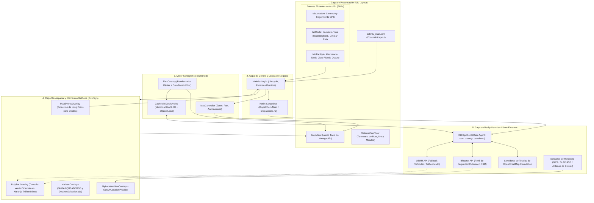
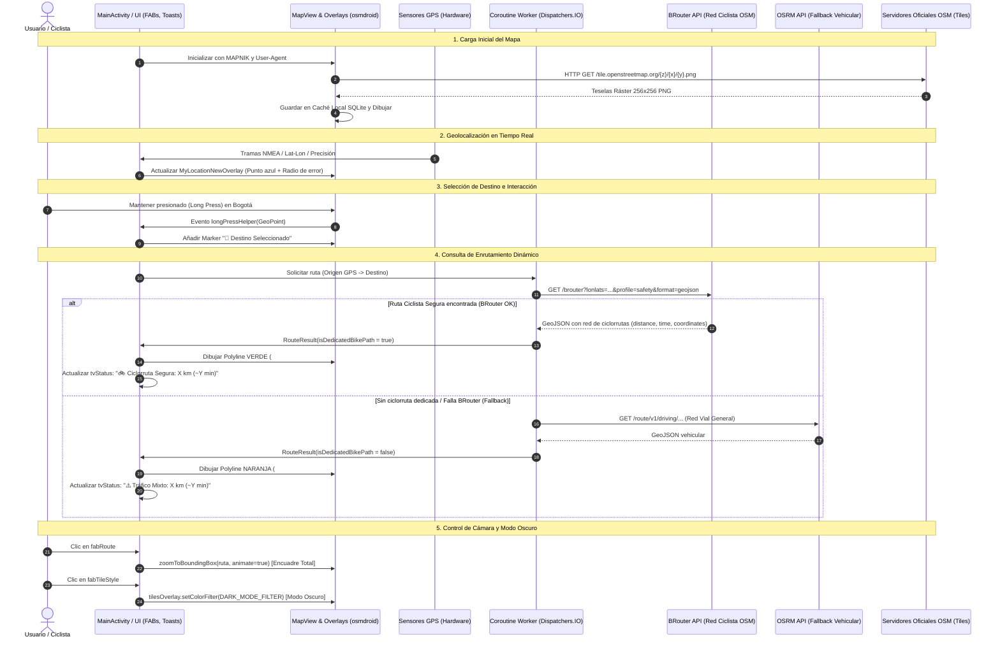
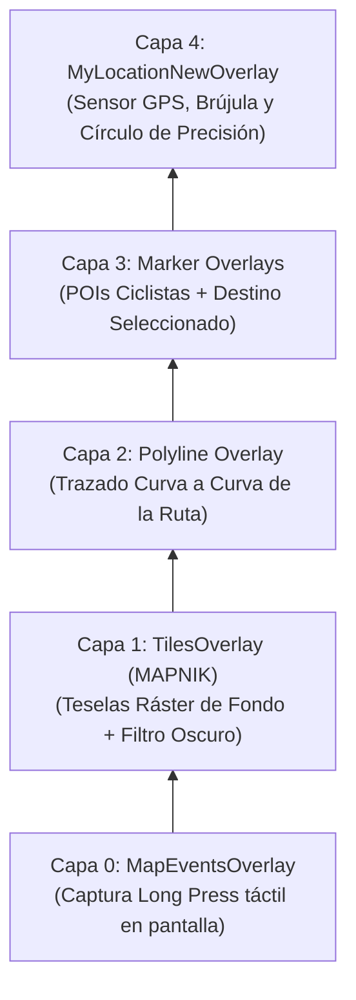

# Documento de Arquitectura de Software: UrbanGO Demo (Android & OpenStreetMap)

Este documento describe detalladamente la **arquitectura técnica**, el **rol de cada archivo**, el **flujo de datos de extremo a extremo**, las **APIs geoespaciales consumidas** y la **representación visual en pantalla** de la aplicación móvil **UrbanGO Demo**.

---

## 1. Visión General de la Solución

**UrbanGO Demo** es una aplicación móvil nativa para Android desarrollada en **Kotlin** para la presentación y validación del proyecto UrbanGO ("el Waze ciclista para Bogotá") en las asignaturas de Geomática y Desarrollo de Aplicaciones Móviles (DADM) en la Universidad Nacional de Colombia.

### Principios de Diseño
* **Soberanía y $0 Costos de Licencia:** Prescinde de plataformas privativas (Google Maps Platform, Mapbox comercial), utilizando el ecosistema abierto de **OpenStreetMap (OSM)**.
* **Cero API Keys Requeridas:** Todas las consultas cartográficas, de enrutamiento y geolocalización operan sin depender de tokens pagos o registros con tarjeta de crédito.
* **Enrutamiento Consciente del Ciclista (Bikeability / LTS):** Diferenciación visual entre infraestructura segregada (ciclorrutas seguras LTS 1) y vías de tráfico mixto vehicular.
* **Resiliencia y Modo Offline:** Almacenamiento local en caché de teselas y mecanismos de fallback ante pérdida de señal satelital o de red.

### 1.1 Diagrama de Arquitectura de la Solución Actual

La aplicación implementa una **arquitectura por capas desacopladas (Layered Spatial Architecture)**, articulando la interfaz reactiva, el controlador del ciclo de vida, el motor cartográfico, los overlays espaciales y los servicios web abiertos:



---

## 2. Mapa y Rol de Archivos del Proyecto

```
Presentacion/OSMAndroidDemo/
├── build.gradle.kts (Nivel Proyecto)
├── settings.gradle.kts
├── README.md
└── app/
    ├── build.gradle.kts (Módulo Aplicación)
    └── src/
        └── main/
            ├── AndroidManifest.xml
            ├── res/
            │   └── layout/
            │       └── activity_main.xml
            └── java/
                └── com/urbango/osmdemo/
                    └── MainActivity.kt
```

| Archivo | Responsabilidad y Componentes Clave |
| :--- | :--- |
| [MainActivity.kt](./OSMAndroidDemo/app/src/main/java/com/urbango/osmdemo/MainActivity.kt) | **Controlador central de la aplicación:**<br/>• Administra el ciclo de vida de la Activity y del `MapView` (`onResume`, `onPause`, `onDestroy`).<br/>• Gestiona los permisos de localización en tiempo de ejecución (`ACCESS_FINE_LOCATION`).<br/>• Coordina el hilo de interfaz con hilos de fondo mediante **Kotlin Coroutines** (`Dispatchers.IO` / `Dispatchers.Main`).<br/>• Implementa la lógica de red HTTP con **OkHttp** para consultar BRouter y OSRM.<br/>• Configura los `Overlays` de mapa (sensores GPS, marcadores, polilíneas y eventos táctiles). |
| [activity_main.xml](./OSMAndroidDemo/app/src/main/res/layout/activity_main.xml) | **Definición de Interfaz de Usuario (UI):**<br/>• `ConstraintLayout` como contenedor raíz fluido.<br/>• `org.osmdroid.views.MapView`: Ocupa el 100% de la pantalla para el renderizado cartográfico.<br/>• `MaterialCardView` superior: Muestra dinámicamente la telemetría, distancia, tiempo y tipo de ruta.<br/>• Tres `FloatingActionButton` (FABs): Disparadores de acciones espaciales (GPS, encuadre de ruta y modo oscuro). |
| [AndroidManifest.xml](./OSMAndroidDemo/app/src/main/AndroidManifest.xml) | **Manifiesto del Sistema Android:**<br/>• Declara los permisos de red (`INTERNET`, `ACCESS_NETWORK_STATE`).<br/>• Declara los permisos de posicionamiento satelital y por celdas (`ACCESS_FINE_LOCATION`, `ACCESS_COARSE_LOCATION`).<br/>• Declara el tema visual Material 3 (`Theme.Material3.DayNight.NoActionBar`). |
| [app/build.gradle.kts](./OSMAndroidDemo/app/build.gradle.kts) | **Configuración de Dependencias y Compilación:**<br/>• `compileSdk = 34`, `minSdk = 24`, Java 17.<br/>• Habilitación de `viewBinding = true`.<br/>• Inclusión de `osmdroid-android:6.1.18` (motor cartográfico).<br/>• Inclusión de `okhttp:4.12.0` (cliente HTTP para APIs de enrutamiento).<br/>• Inclusión de `kotlinx-coroutines-android:1.7.3` (concurrencia reactiva). |

---

## 3. Diagrama de Flujo de Datos

El siguiente diagrama ilustra el flujo de información desde la interacción táctil del usuario y los sensores hasta la renderización en el canvas:



---

## 4. APIs y Servicios Remotos Consumidos

### A. Servidor Oficial de Teselas de OpenStreetMap Foundation (OSMF)
* **Objetivo:** Proporcionar las imágenes ráster del mapa base de Bogotá en tiempo real.
* **Protocolo:** HTTP/HTTPS GET basado en la especificación **Slippy Map ($z/x/y$)**.
* **URL:**  
  `https://tile.openstreetmap.org/{z}/{x}/{y}.png`
* **Proyecciones Cartográficas:**
  * Entrada: Coordenadas geográficas **WGS84 (EPSG:4326)**.
  * Renderizado: Proyección conforme cilíndrica **Web Mercator (EPSG:3857)**.
* **Políticas de Uso (Tile Usage Policy):**
  Es obligatorio identificar la aplicación mediante una cabecera `User-Agent`. En `MainActivity.kt` se inyecta programáticamente:
  ```kotlin
  Configuration.getInstance().userAgentValue = packageName
  ```

---

### B. BRouter API (Enrutador Especializado en Bicicletas de OSM)
* **Objetivo:** Calcular la ruta ciclista óptima respetando la red de ciclorrutas protegidas, andenes autorizados y vías de bajo tráfico vehicular de Bogotá.
* **Endpoint:**  
  `https://brouter.de/brouter?lonlats={lon1},{lat1}%7C{lon2},{lat2}&profile=safety&alternativeidx=0&format=geojson`
* **Parámetros Clave:**
  * `lonlats`: Coordenadas de origen y destino en formato `longitud,latitud` separadas por `%7C` (tubería codificada).
  * `profile=safety`: Perfil de costo que penaliza vías primarias sin ciclorruta e incentiva tramos con etiquetas `highway=cycleway`, `cycleway=track` y `bicycle=yes`.
  * `format=geojson`: Retorna la respuesta en formato estándar RFC 7946 GeoJSON.
* **Estructura del Payload Recibido:**
  ```json
  {
    "type": "FeatureCollection",
    "features": [
      {
        "type": "Feature",
        "properties": {
          "track-length": "6751", // Distancia en metros
          "total-time": "989"     // Tiempo estimado en segundos
        },
        "geometry": {
          "type": "LineString",
          "coordinates": [
            [-74.074819, 4.599131, 2614.0],
            [-74.074808, 4.599149, 2614.0],
            ...
          ]
        }
      }
    ]
  }
  ```

---

### C. OSRM API (Open Source Routing Machine - Fallback Vehicular)
* **Objetivo:** Servidor de contingencia (*fallback*) cuando un punto no cuenta con conexión de ciclorruta directa o cuando el servicio ciclista presenta indisponibilidad.
* **Endpoint:**  
  `https://router.project-osrm.org/route/v1/driving/{lon1},{lat1};{lon2},{lat2}?overview=full&geometries=geojson`
* **Comportamiento en la App:** Si la ruta se resuelve mediante este motor, la aplicación detecta que el ciclista deberá compartir vía con vehículos motorizados y activa la alerta visual en color **Naranja (`#FF6D00`)**.

---

## 5. Representación y Renderizado Espacial en Pantalla

El sistema de capas en pantalla se gestiona mediante la lista de `Overlays` de `MapView`, evaluados en orden de prioridad de dibujo e interacción:



### 1. Codificación Semántica por Colores (Bikeability / LTS)
* **Verde Neón Brillante (`#00E676`):** Representa infraestructura segregada segura (**LTS 1 / LTS 2** - Ciclorrutas exclusivas, bicicarriles protegidos, ciclovía dominical).
* **Naranja Alerta Intenso (`#FF6D00`):** Representa calzada vehicular mixta (**LTS 3 / LTS 4** - Vías donde el ciclista comparte espacio con buses o automóviles).

### 2. Modo Oscuro Nativo por Filtro Matricial
En lugar de depender de proveedores externos de teselas oscuras con marcas de agua o API keys de pago, la app aplica una transformación matricial en el espacio de color sobre el canal de teselas:
```kotlin
val darkColorMatrix = ColorMatrix(floatArrayOf(
    -0.85f,  0.0f,   0.0f,   0.0f, 240.0f, // R
     0.0f,  -0.85f,  0.0f,   0.0f, 240.0f, // G
     0.0f,   0.0f,  -0.80f,  0.0f, 245.0f, // B
     0.0f,   0.0f,   0.0f,   1.0f,   0.0f  // Alpha
))
mapView.overlayManager.tilesOverlay.setColorFilter(ColorMatrixColorFilter(darkColorMatrix))
```
Esta transformación se procesa en el pipeline gráfico local del dispositivo a 0 ms de latencia y sin consumir ancho de banda de red.

### 3. Encuadre Inteligente de Cámara (`BoundingBox`)
Al presionar el botón `fabRoute`, el sistema toma la lista de vértices de la ruta activa y calcula el polígono envolvente mínimo:
```kotlin
val boundingBox = BoundingBox.fromGeoPoints(currentRoutePoints)
mapView.zoomToBoundingBox(boundingBox, true, 140)
```
La cámara se ajusta con una animación suave (*easing*) dejando 140 píxeles de margen (*padding*) para que el origen, el destino y los giros queden visibles simultáneamente en el viewport.

---

## 6. Manejo de Errores y Robustez

1. **Pérdida de Señal GPS:** Si el sensor satelital no ha triangulado la posición o la app se ejecuta en un emulador sin mock location, la app toma automáticamente las coordenadas de la **Plaza de Bolívar ($4.5981^\circ, -74.0760^\circ$)** como punto de origen de respaldo informando al usuario vía `Toast`.
2. **Ciclo de Vida y Prevención de Fugas de Memoria:**
   En `onDestroy()`, se invoca `coroutineScope.cancel()` para cancelar inmediatamente cualquier petición HTTP en curso si el usuario cierra la aplicación, previniendo fugas de memoria (*memory leaks*).
3. **Caché en Modo Avión:**
   Las teselas consultadas se almacenan automáticamente en la base de datos interna SQLite de Android. Si se corta el internet, la zona de Bogotá previamente visualizada sigue navegable en pantalla.
